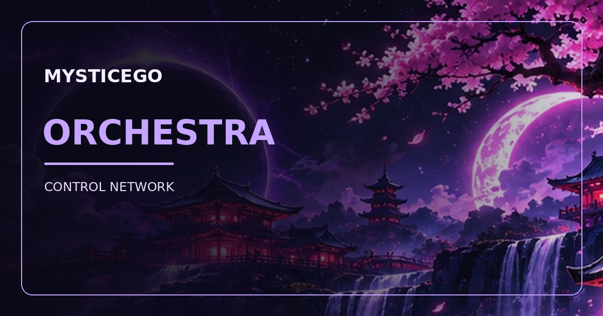
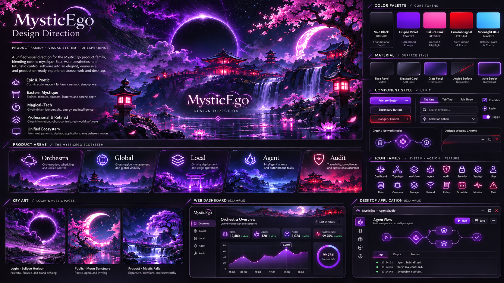
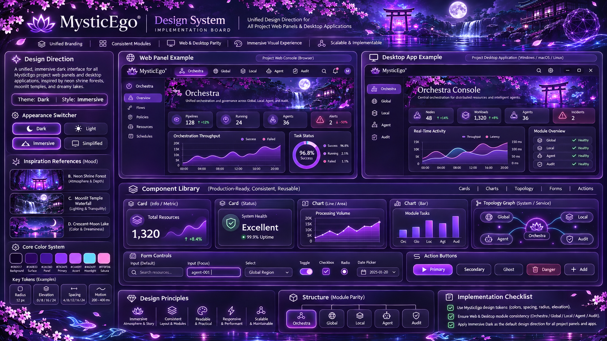
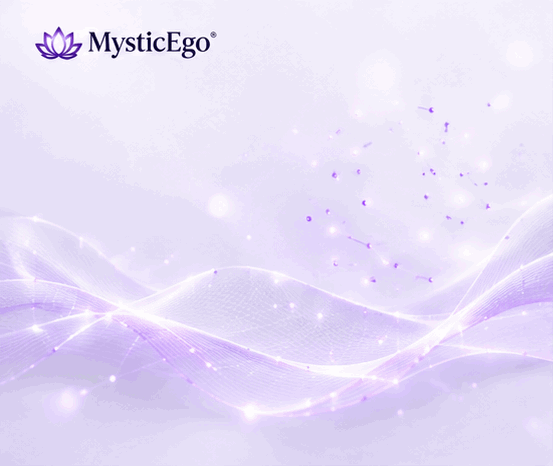
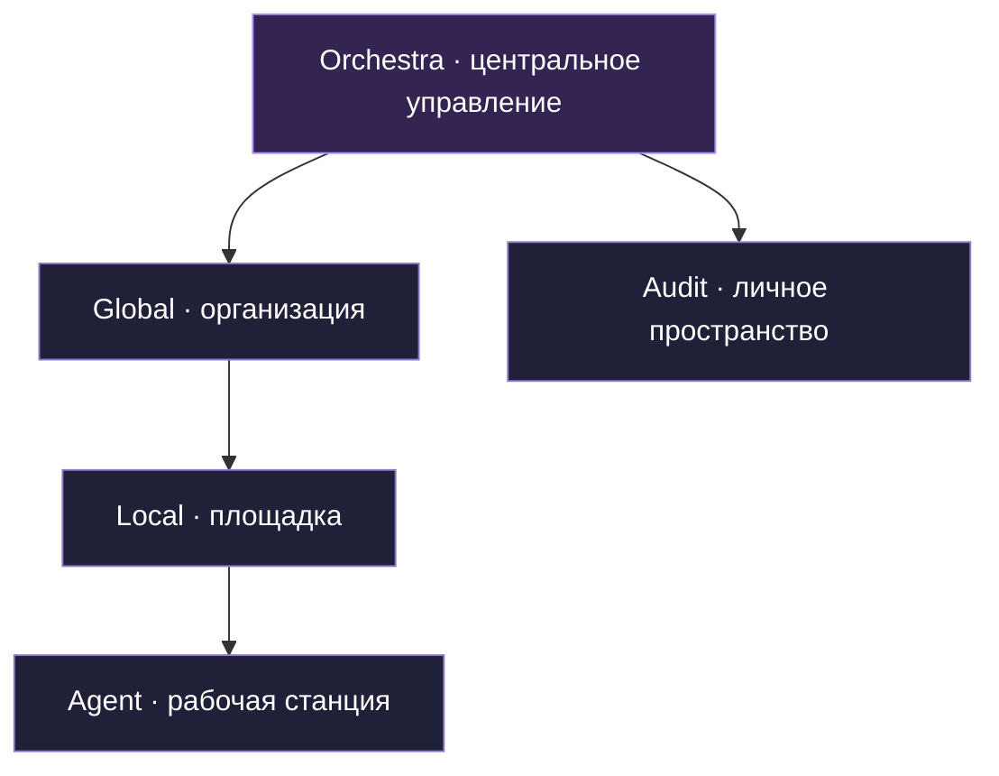

<div align="center">

<a href="https://orchestra.isdarkline.ru/">
  
</a>

# MYSTICEGO

**Экосистема управления компьютерами, инфраструктурой и персональными ИИ-ассистентами**

Организации · Площадки · Рабочие станции · Личное пространство · Интерактивный VRM

[**Скачать приложения**](https://github.com/ZeroFantom/MysticEgo/releases) · [Открыть Orchestra](https://orchestra.isdarkline.ru/) · [Студия](https://orchestra.isdarkline.ru/studio) · [Разработчик](https://orchestra.isdarkline.ru/developer)

<sub>C# / .NET 10 &nbsp; • &nbsp; TypeScript / React &nbsp; • &nbsp; Electron &nbsp; • &nbsp; Windows / Linux</sub>

[Возможности](#возможности) · [Галерея](#галерея) · [Архитектура](#архитектура) · [Установка](#установка) · [Разработка](#разработка)

</div>

---

## Возможности

MysticEgo — развиваемая платформа с доступным исходным кодом для распределённых рабочих станций и персональной автоматизации. Она связывает центральную панель, организации, площадки и компьютеры, позволяя наблюдать за их состоянием, обновлять компоненты и выполнять разрешённые операции. Следующее направление — единый персональный ИИ-ассистент, который работает в веб-панели и на рабочем столе, разговаривает через VRM-аватар и помогает пользователю выполнять задачи.

| Инфраструктура | Личное пространство |
| :--- | :--- |
| Реестр узлов и топология сети | Профиль и участие в организациях |
| Диагностика и наблюдение за рабочими станциями | Чаты, голосовые сообщения и расшифровка |
| Развёртывание и обновление серверов через CloudDesk | Аватары VRM, анимации VRMA и стикеры |
| Управление площадками и приглашениями | Настольный аватар-ассистент |

Операции выполняются в соответствии с ролями и разрешениями. Служебные данные не публикуются в карточках ссылок.

## Интерактивный ассистент и Computer Use

> Экспериментальная ветка: [PR #72](https://github.com/ZeroFantom/MysticEgo/pull/72). Описанные ниже новые компоненты находятся на этапе разработки и проверки, не являются обещанием возможностей опубликованных релизов.

| Направление | Состояние |
| :--- | :--- |
| Видимый Chromium и управление Electron | Прототип Playwright, MCP и REST |
| Agent / Audit | Локальный авторизованный мост к исполнителю; ручная настройка |
| Запись и воспроизведение | Запись кликов Windows и семантических действий ассистента, переносимые сценарии |
| Windows / KDE Plasma X11 | Экспериментальные адаптеры окон, системных настроек, анимаций и рабочих столов; Linux-управление окнами ещё не завершено |
| VRM Web → Desktop | Прототип передачи профиля, движения, фазы и эмоции с локальным подтверждением |
| Липсинк | Приближённая синхронизация текста и TTS, сглаживание пяти форм рта |
| Генерация | Семь процедурных VRMA-клипов, шаблон VRM с морфами рта и тремя палитрами |

**Цель — «вторые руки» пользователя:** ассистент выполняет параллельные задачи в выделенном окне или через API, не перехватывая физический ввод. Независимый курсор, полноценная нативная маршрутизация, двусторонний бесшовный VRM-переход, фонемный липсинк, нейросетевая генерация произвольных моделей, автоматические обновления OEM-драйверов и изменение аппаратного DPI пока не завершены.

Браузерные Agent/Audit и их настольные версии — два интерфейса одного локального узла. Нативные операции требуют локального исполнителя, авторизации и явного разрешения. Поддерживаемые графические сессии нового интерактивного режима — Windows и Linux X11, приоритет KDE Plasma. Wayland и XWayland не поддерживаются. Серверное развёртывание без графической среды этим ограничением не затрагивается.

[UI Automation и MCP](tools/MysticEgo.UiAutomation/README.md) · [Контракт Agent/Audit](docs/agent-audit-computer-control.md) · [Передача VRM](docs/local-desktop-handoff.md)

## Галерея

Историческое обновление оформления: [BETA7 R3.2.38](docs/releases/beta7-r3.2.38.md).

Две визуальные концепции, каждая в светлой и тёмной версии. Насыщенный стиль вдохновлён ночными восточноазиатскими пейзажами и фантастической атмосферой; упрощённый — геометрией сетей и спокойными поверхностями.

<table>
  <tr>
    <td width="50%" align="center">
      <a href="frontend/packages/ui/src/app/appearance-art/immersive-dark-hero.webp"></a>
      <br><b>01 · IMMERSIVE DARK</b><br><sub>Лунный свет · глубина · фиолетовые акценты</sub>
    </td>
    <td width="50%" align="center">
      <a href="frontend/packages/ui/src/app/appearance-art/immersive-light-hero.webp"></a>
      <br><b>02 · IMMERSIVE LIGHT</b><br><sub>Светлые поверхности · мягкие оттенки</sub>
    </td>
  </tr>
  <tr>
    <td width="50%" align="center">
      <a href="frontend/packages/ui/src/app/appearance-art/simplified-dark-hero.webp"></a>
      <br><b>03 · SIMPLIFIED DARK</b><br><sub>Геометрия · минимум визуального шума</sub>
    </td>
    <td width="50%" align="center">
      <a href="frontend/packages/ui/src/app/appearance-art/simplified-light-hero.webp"></a>
      <br><b>04 · SIMPLIFIED LIGHT</b><br><sub>Чистые поверхности · лёгкие акценты</sub>
    </td>
  </tr>
</table>

Цветовая тема и стиль переключаются независимо. По умолчанию выбран Simplified Dark. Поддерживаются четыре типа переходов — Flow, Fade, Slide и Scale — и три уровня интенсивности движения, включая отключение анимации.

<details>
<summary><b>Концепты интерфейса и анимация</b></summary>

<br>

<p align="center">
  <a href="docs/design/generated/a_highly_detailed_cinematic_ui_design_direction_b_1.png">
    
  </a>
</p>

<p align="center">
  <a href="docs/design/generated/a_highly_detailed_polished_production_ready_ui_d_2_batch_1.png">
    
  </a>
</p>

<p align="center">
  <a href="docs/design/generated/a_wide_clean_cinematic_tech_themed_promotional_h_7_batch_6.gif">
    
  </a>
</p>

<sub>Иллюстрации и анимированные концепты — исходные дизайн-материалы, а не скриншоты работающей системы. Изображения интерфейса используют оптимизированные фрагменты этих материалов.</sub>

</details>

[Все оригинальные изображения и GIF](docs/design/generated/README.md) · [Система оформления](docs/appearance-system.md) · [Карточки ссылок и Open Graph](docs/panel-social-motion.md)

---

## Архитектура



| Компонент | Ответственность |
| :--- | :--- |
| **Orchestra** | Центральный реестр, доступ к узлам, развёртывание и обновления |
| **Global** | Организация и её площадки |
| **Local** | Площадка, выпуск приглашений и связь со станциями |
| **Agent** | Регистрация станции, диагностика и разрешённые действия |
| **Audit** | Личный профиль и подключение к организациям |
| **Auth** | Учётные записи, токены и управление доступом |

Auth обеспечивает управление доступом; схема показывает логическую иерархию узлов, а не все сетевые соединения.

<details>
<summary><b>Технологии и структура исходников</b></summary>

| Уровень | Технологии | Каталог |
| :--- | :--- | :--- |
| Серверные сервисы | C# / .NET 10 | [services/](services/) |
| Веб-панели | TypeScript, React, Vite | [frontend/apps/](frontend/apps/) |
| Общий веб-интерфейс | React, CSS | [frontend/packages/ui/](frontend/packages/ui/) |
| Настольные приложения | Electron | [desktop/](desktop/) |
| Интерактивный исполнитель (эксперимент) | Node.js, Playwright, MCP, Win32, KWin D-Bus | [tools/MysticEgo.UiAutomation/](tools/MysticEgo.UiAutomation/) |
| VRM / VRMA | Three.js, @pixiv/three-vrm | [avatar/](frontend/packages/ui/src/avatar/) |
| CloudDesk | C#, React, Electron | [tools/MysticEgo.CloudDesk/](tools/MysticEgo.CloudDesk/) |
| Общие модели и код | .NET | [core/](core/), [shared/](shared/), [Distributed](services/MysticEgo.Distributed/) |
| Развёртывание | Скрипты инфраструктуры | [ops/](ops/) |

</details>

## Установка

**Начните со страницы [GitHub Releases](https://github.com/ZeroFantom/MysticEgo/releases).**

Для релизов с отдельными установщиками скачайте **один файл нужного приложения**. Windows — EXE, Linux x64 — RUN (например, `bash MysticEgo-AuditDesktop-linux-x64.run`). Комплектные .NET и Electron устанавливаются в пользовательский каталог. Старые ZIP остаются резервным вариантом.

| Приложение | Назначение | Windows x64 | Linux x64 |
| :--- | :--- | :--- | :--- |
| AuditDesktop | Личный Audit | EXE | RUN |
| AgentDesktop | Рабочая станция клуба | EXE | RUN |
| LocalDesktop | Управление площадкой | EXE | RUN |
| CloudDesk | Локальный центр Auth/Orchestra и управление облаком | EXE | RUN |

[Установка и системные зависимости](ops/desktop-releases/README.md). Для новых AgentDesktop/AuditDesktop из экспериментальной ветки требуется Windows или полноценная X11-сессия Linux. На KDE выбирайте Plasma (X11) при входе.

**Как подключить площадку:** создайте её в Global, получите конфигурацию через LocalDesktop, затем выпустите приглашение в панели Local. AgentDesktop получает профиль станции по сети площадки. Для личного использования можно начать с AuditDesktop.

[Руководство по развёртыванию](ops/infrastructure/README.md) · [Обновление Orchestra](ops/orchestra-updater/README.md)

---

## Разработка

Понадобятся **.NET 10 SDK** и **Node.js 24**. Выполните из корня репозитория:

```bash
dotnet build MysticEgo.Distributed.slnx
npm ci --prefix frontend
npm run build --prefix frontend
```

Для разработки веб-интерфейса Orchestra:

```bash
npm run dev:orchestra --prefix frontend
```

Vite запускает интерфейс; для входа потребуется работающий API. Остальные команды — в [frontend/package.json](frontend/package.json).

<details>
<summary><b>Проверки оформления и карточек ссылок</b></summary>

```bash
npm run test:appearance --prefix frontend
npm run test:social --prefix frontend
```

[GitHub Actions](https://github.com/ZeroFantom/MysticEgo/actions) · [Как внести изменения](CONTRIBUTING.md)

</details>

## Документация

[Состояние разработки и дорожная карта](docs/development-roadmap.md) · [Development Workspace и GitHub](docs/development-workspace.md) · [Безопасность учётных данных](docs/credential-security.md)

Экспериментальные возможности отмечены отдельно от изменений, влитых в main.

| Раздел | Руководство |
| :--- | :--- |
| Оформление и анимации | [Appearance system](docs/appearance-system.md) |
| Языки, шрифты, настройки аккаунта (эксперимент) | [Localization](docs/localization.md) |
| Превью для Telegram и VK | [Social previews](docs/panel-social-motion.md) |
| Чаты и профиль | [Коллектив: голосовые, ответы, редактирование, удаление и пересылка](docs/collective-chat.md) |
| Аватары и стикеры | [Создание VRM / VRMA и стикеров](docs/avatar-creation.md) |
| Ассистент | [Установка и настройка](ops/panel-assistant/README.md) |
| Безопасность аккаунта | [Регистрация, сессии и разрешения устройств](docs/account-security.md) |
| Computer Use / MCP | [Локальный исполнитель](tools/MysticEgo.UiAutomation/README.md) |
| Системная автоматизация | [Agent / Audit](docs/agent-audit-computer-control.md) |
| Переход VRM между средами | [Local Desktop Handoff](docs/local-desktop-handoff.md) |
| Развёртывание | [Инфраструктура](ops/infrastructure/README.md) |
| Обновления | [Orchestra Updater](ops/orchestra-updater/README.md) |
| История эксплуатации | [Operations notes](docs/operations-notes.md) |

## О студии

<p align="center">
  <a href="https://orchestra.isdarkline.ru/studio"></a>
</p>

MysticEgo — независимая студия программного обеспечения и игровых систем. Направления: распределённая инфраструктура MysticEgo, CloudDesk для развёртывания серверов, персональный ИИ-ассистент с VRM и Computer Use в разработке, а также концепция **Ether And Chaos** — живого фэнтезийного мира с самостоятельными персонажами, историей и последствиями решений игроков. Студия объединяет инженерную автоматизацию, интерфейсы, интерактивных персонажей и игровые системы.

Текущий этап инфраструктуры и ассистента, игровой замысел и возможности сотрудничества, рекламы или финансирования разработки описаны на [сайте студии](https://orchestra.isdarkline.ru/studio).

[Предложить улучшение](https://github.com/ZeroFantom/MysticEgo/issues) · [Профиль разработчика](https://orchestra.isdarkline.ru/developer)

## Лицензия

[**Лицензия MysticEgo на сайте**](https://orchestra.isdarkline.ru/license) — краткое пояснение, полный оригинальный текст, скачивание и контакт для коммерческого разрешения.


Код текущей редакции, принадлежащий DarkLie:Zero, доступен по [PolyForm Noncommercial 1.0.0](LICENSE). Для коммерческого использования, которое не покрывает эта лицензия, требуется [отдельное письменное разрешение](docs/legal/commercial.md). У прежних версий под Apache 2.0 и сторонних компонентов сохраняются их лицензии.

[Проверка документов регистрации](docs/legal/launch-review.md)

---

<div align="center">

**MYSTICEGO**

<sub>DarkLie:Zero · Infrastructure / Software / Worlds</sub>

[Сайт](https://orchestra.isdarkline.ru/studio) · [Релизы](https://github.com/ZeroFantom/MysticEgo/releases) · [Задачи и обсуждения](https://github.com/ZeroFantom/MysticEgo/issues)

</div>


### Хранение данных

SQLite по умолчанию. Для новых узлов — PostgreSQL, локальный или удалённый, обычная установка или Docker. [Настройка и ограничения миграции](ops/infrastructure/README.md#sqlite-и-postgresql).

### Traffic protection

[Защита от перегрузки и DDoS: HTTP admission, прокси, ограничения и развёртывание](docs/traffic-protection.md).

### Capacity & resilience (experimental)

[Capacity analyzer, independent collector, browser sessions and safe standby activation](docs/capacity-resilience.md) · [Orchestra high availability rollout gates](ops/security/orchestra-ha.md).
